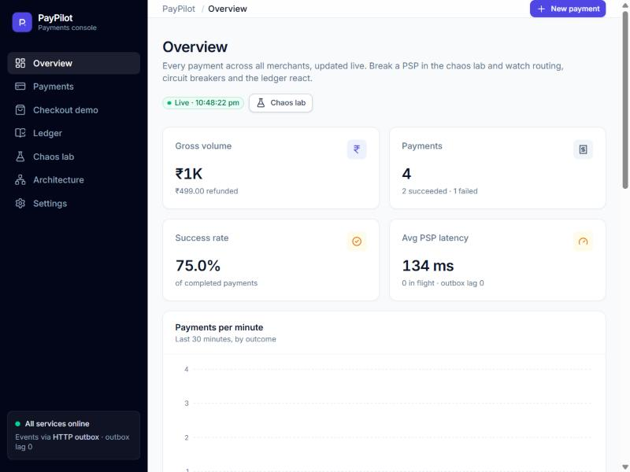
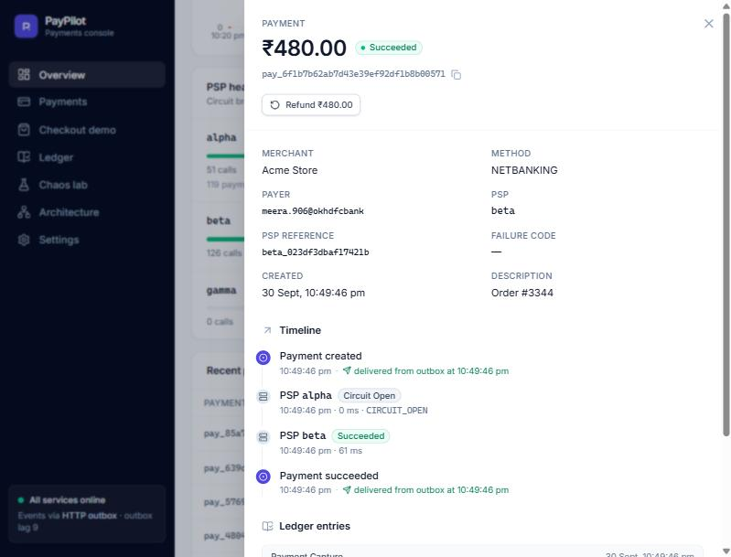
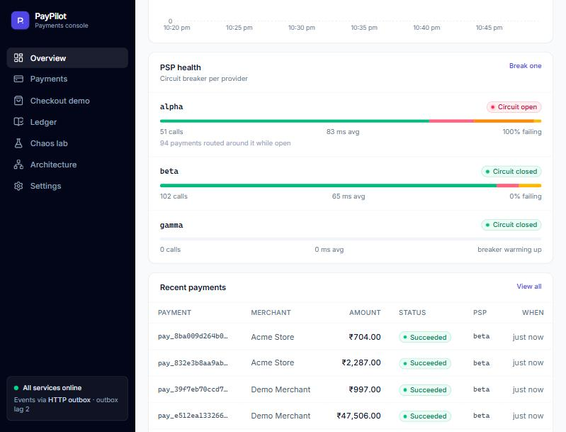
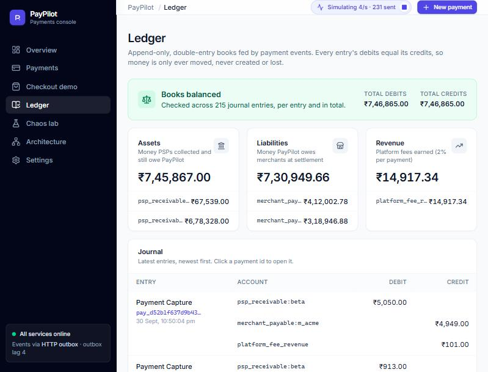
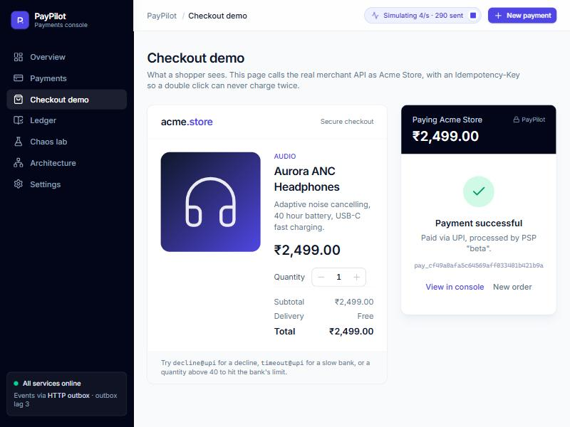
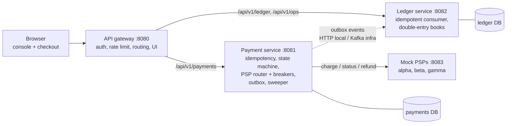

# PayPilot

A UPI-style payment platform built as four Spring Boot services plus a React console. It routes each payment across three payment service providers (PSPs), fails over safely when one goes down, and records every rupee in a double-entry ledger that must always balance. A chaos lab lets you break the PSPs on purpose and watch the system recover.



## What it shows

- **Idempotent payments API.** Retrying `POST /payments` with the same `Idempotency-Key` returns the original payment and never charges twice. Reusing a key with a different body is rejected.
- **Safe PSP failover.** When a PSP refuses a call, the payment moves to the next PSP. When a PSP times out, the payment is *not* retried elsewhere, because the customer may already be charged. A sweeper asks the PSP what happened instead.
- **Circuit breakers per PSP** (Resilience4j). A failing PSP is skipped instantly instead of slowing every payment down.
- **Transactional outbox.** A payment change and its event commit in one database transaction. No lost events, no phantom events.
- **Double-entry ledger.** Append-only journal fed by events, with an idempotent consumer, reversing entries for refunds, and an integrity check proving debits equal credits.
- **API gateway.** API-key authentication, per-merchant rate limiting (token bucket), request ids, and admin-only ops routes.
- **Ports and adapters.** The same code runs with nothing installed (H2, HTTP events, in-memory locks) or production-style (Postgres, Kafka, Redis) by switching a Spring profile.
- **Ops console.** Live KPIs, a payment timeline, ledger views, a checkout demo, a traffic simulator and PSP fault injection.

| Payment timeline | PSP outage: circuit open, traffic routed around it |
|---|---|
|  |  |
| **Ledger (balanced mid-outage)** | **Checkout demo** |
|  |  |

## Architecture



| Service | Port | Responsibility |
|---|---|---|
| `api-gateway` | 8080 | Single entry point. Serves the console, checks API keys, rate limits per merchant, routes. |
| `payment-service` | 8081 | Payment intents, idempotency, PSP routing with circuit breakers, outbox, timeout sweeper, ops read model. |
| `ledger-service` | 8082 | Consumes payment events and posts balanced journal entries. |
| `mock-psp` | 8083 | Three simulated PSPs with a fault-injection API (outages, errors, declines, timeouts, latency). |
| `paypilot-common` | – | Event contract and shared constants. |
| `frontend` | – | React 19 + TypeScript console. Its build is served by the gateway. |

## Run it

**You need:** JDK 17 or newer (JDK 21 recommended) and Maven 3.9+. Node.js is only needed if you want to change the UI. No Docker, no database install.

**Windows (PowerShell):**

```powershell
.\run-local.ps1
```

**macOS / Linux / Git Bash:**

```bash
./run-local.sh
```

The script builds everything, starts the four services, waits until they are healthy, and opens **http://localhost:8080**. The first build downloads dependencies and takes a few minutes; after that it's fast (`.\run-local.ps1 -SkipBuild`).

Stop everything with `.\stop-local.ps1` (or `./run-local.sh --stop`). Start with an empty database with `.\run-local.ps1 -Fresh`.

If PowerShell refuses to run the script, allow local scripts for your user once:

```powershell
Set-ExecutionPolicy -Scope CurrentUser RemoteSigned
```

## A five-minute tour

1. **Overview.** Empty at first. Click **New payment**, keep "send twice" ticked and charge. The second call comes back `200` with `Idempotent-Replayed`, and it's the same payment.
2. **Checkout demo.** Pay as a shopper. Then try the UPI id `decline@upi` (declined) and `timeout@upi` (the bank is slow; the payment stays pending until the sweeper confirms it, about 10 seconds).
3. **Chaos lab.** Start the traffic simulator, then click **Alpha outage**. On the overview, alpha's circuit opens and traffic moves to beta. Try **Alpha timeouts** and **Total outage** too.
4. **Payments.** Click any payment to see its timeline: every PSP tried, the outcome, the latency, the outbox delivery and the ledger entries.
5. **Ledger.** Whatever you broke, it should still say **Books balanced**.
6. **Architecture.** A summary of the design for anyone reviewing the project.

Command-line check of the whole flow (15 assertions):

```powershell
.\scripts\smoke-test.ps1
```

## API quick reference

All calls go through the gateway on port 8080. Demo keys (local only): merchant `pk_test_demo_merchant` or `pk_test_acme_store`, admin `sk_admin_demo_only`.

```bash
curl -X POST http://localhost:8080/api/v1/payments \
  -H "X-Api-Key: pk_test_demo_merchant" \
  -H "Idempotency-Key: order-1042-attempt-1" \
  -H "Content-Type: application/json" \
  -d '{"amount": 49900, "currency": "INR", "method": "UPI", "payer": "anishka@okaxis", "description": "Order #1042"}'
```

Amounts are in paise (`49900` = ₹499.00). More examples are in [`requests.http`](requests.http), and interactive docs are at http://localhost:8081/swagger-ui.html and http://localhost:8082/swagger-ui.html.

| Endpoint | Key | Purpose |
|---|---|---|
| `POST /api/v1/payments` | merchant | Create a payment (needs `Idempotency-Key`) |
| `GET /api/v1/payments/{id}` | merchant | Fetch one of your payments |
| `GET /api/v1/payments/{id}/attempts` | merchant | Every PSP tried and what happened |
| `POST /api/v1/payments/{id}/refund` | merchant | Full refund |
| `GET /api/v1/ledger/accounts` · `/integrity` · `/entries` | admin | Ledger balances, integrity proof, journal |
| `GET /api/v1/ops/stats` · `/payments` · `/attempts/recent` | admin | Ops read model across merchants |
| `PUT /api/v1/ops/chaos/{psp}` · `POST /api/v1/ops/chaos/reset` | admin | Fault injection on the mock PSPs |

## Tests

```bash
mvn verify
```

- Unit tests: payment state machine, failover rules, idempotency fingerprint, posting rules, journal balancing, gateway auth filter.
- Spring Boot tests on in-memory H2 (`PaymentFlowTest`, `LedgerIngestTest`): the full flow through the real controllers and database. No Docker needed.
- Testcontainers integration tests (`*IT`) run the **infra** profile against real Postgres, Kafka and Redis. They are opt-in because they need Docker: `mvn verify -Pit`.

## Profiles

| | `local` (default) | `infra` |
|---|---|---|
| Database | H2 files in `./data` | PostgreSQL |
| Events | Outbox delivered over HTTP | Outbox published to Kafka, ledger consumes with retries and a dead-letter topic |
| Idempotency lock | In memory | Redis (`SET NX` + Lua compare-and-delete) |
| Rate limiting | In-memory token bucket | Redis token bucket (shared by all gateway instances) |

The `infra` profile is wired and covered by the `*IT` tests. Docker Compose for running it day to day comes in the next phase.

## Project layout

```
paypilot/
├── api-gateway/        Spring Cloud Gateway; serves the built console from src/main/resources/static
├── payment-service/    payments, idempotency, routing, outbox, sweeper, ops endpoints
├── ledger-service/     double-entry ledger, event ingestion (HTTP or Kafka)
├── mock-psp/           simulated PSPs with fault injection
├── paypilot-common/    event contract, headers, JDK workaround
├── frontend/           React + TypeScript console (npm run dev / npm run build)
├── docs/               learning guide, design decisions, screenshots
├── scripts/            smoke test
└── run-local.ps1 / run-local.sh / stop-local.ps1
```

## Working on the UI

```bash
cd frontend
npm install
npm run dev      # http://localhost:5173, proxies /api to the running gateway
npm run build    # writes into api-gateway/src/main/resources/static
```

## Troubleshooting

| Problem | Fix |
|---|---|
| `PKIX path building failed` during the Maven build | Antivirus or a proxy is inspecting HTTPS. `run-local.ps1` already sets `-Djavax.net.ssl.trustStoreType=Windows-ROOT`; do the same in `MAVEN_OPTS` when running `mvn` yourself. |
| `Port 8083 is already used by ...` | Another program has the port. Close it or change `server.port` (and the matching URL in the gateway and payment service config). |
| `Unable to establish loopback connection` | A JDK bug on Windows when the temp folder path has a space or `~`. The services fix it at startup (`JdkWorkarounds`) and the Maven build fixes it for tests. |
| A service did not start | Look in `logs/<service>.log`. |
| Want a clean slate | `.\run-local.ps1 -Fresh` deletes `./data`. |

## Learn from it

[`docs/LEARNING-GUIDE.md`](docs/LEARNING-GUIDE.md) walks through each concept in this codebase: where it lives, why it's built that way, and the interview questions it prepares you for. [`docs/DESIGN-DECISIONS.md`](docs/DESIGN-DECISIONS.md) records the main trade-offs.

## Roadmap

- **Phase 2:** Docker Compose with the infra profile, Kafka Streams risk engine, success-rate based routing
- **Phase 3:** AI ops copilot: Spring AI agent with read-only tools over these APIs, RAG over runbooks, exposed as an MCP server
- **Phase 4:** OpenTelemetry tracing, Prometheus and Grafana, k6 load tests with published numbers
- **Phase 5:** Kubernetes on AWS, CI/CD with GitHub Actions
